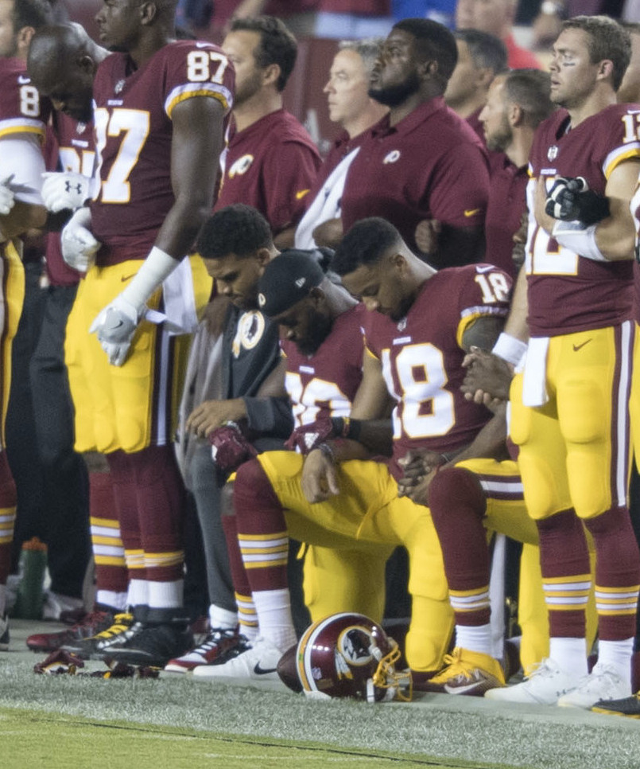
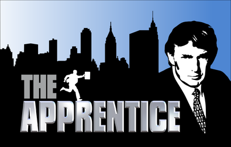
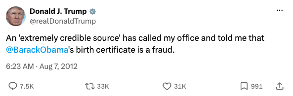
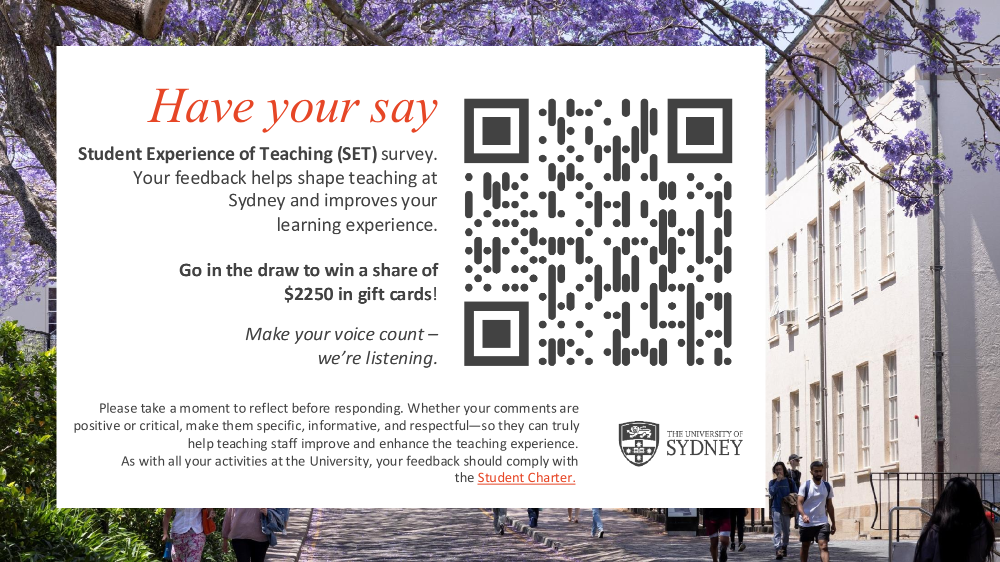
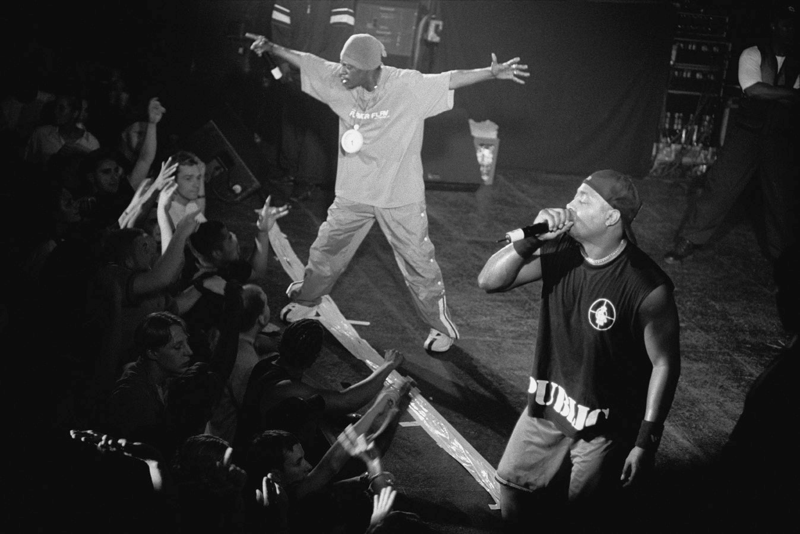
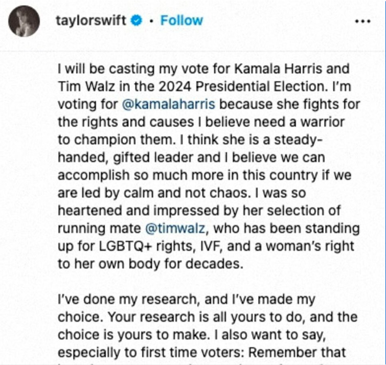
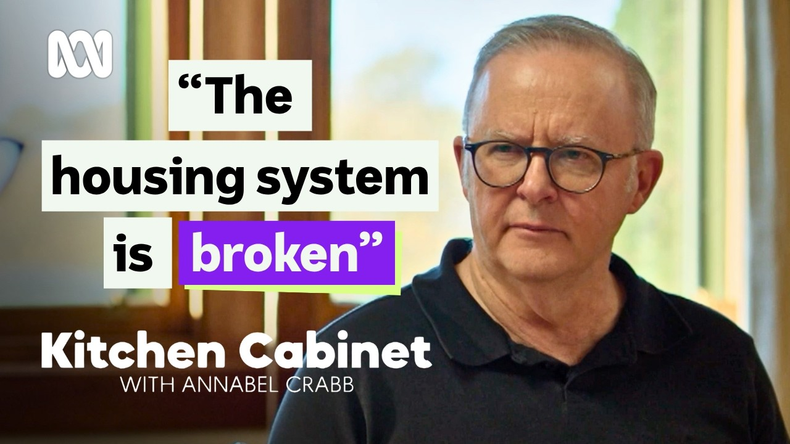
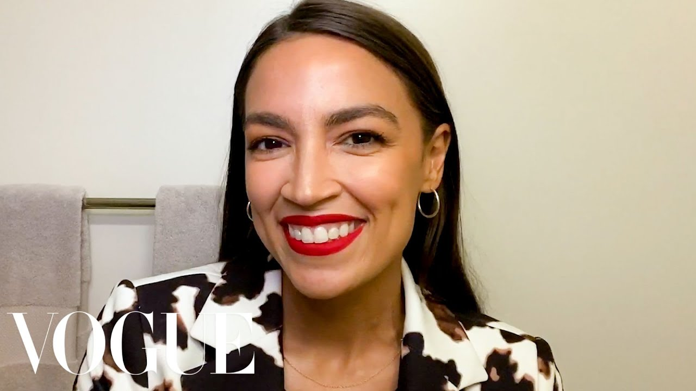

## Acknowledgement of Country

I would like to acknowledge the Traditional Owners of Australia and recognise their continuing connection to land, water and culture. The University of Sydney is located on the land of the Gadigal people of the Eora Nation. I pay my respects to their Elders, past and present.

## Today's class {.smaller}

Platforms, Politics, and Entertainment (Ch 12)

- See why entertainment and popular culture are **sites of politics**, and how the "serious vs popular" distinction came about.
- Distinguish **politicians who become celebrities** from **celebrities who become politicians**, and weigh the two normative readings of each.
- **This week's reading**: Wood, Corbett & Flinders [-@woodJustUsEveryday2016] on **superstar vs everyday celebrity politicians**, and why "being normal" became a political strategy in an age of anti-politics.
- Look at **political influencers**: the everyday-celebrity strategy without an office.
- **Today's question**: is entertainment a fourth, softer route around democratic institutions, and does it widen or hollow out political representation?

::: {.callout-tip}
### Note
When not otherwise referenced, materials are based on and adapted from Klinger, Kreiss & Mutsvairo (2023), *Platforms, Power, and Politics* (Polity), Ch 12.
:::

## Recap: three legs, and a fourth channel {.smaller}

| | Week 3 — Leg 1 | Week 7 — Leg 2 | Week 8 — Leg 3 | Week 12 (today) |
|---|---|---|---|---|
| **Theme** | Algorithmic gatekeeping crisis | Participation paradox | Institutional bypass via Internet capital | Bypass via **fame and entertainment** |
| **Reading** | Soffer (2021) | Heiss & Matthes (2019) | Bailo (2025); Marolla et al. (2026) | Wood et al. (2016) |
| **What is bypassed** | Human gatekeepers (editors, opinion leaders) | The cost of participating | Civic associations and their social capital | Party machines, structured interviews, the "professional politician" |

::: {.callout-tip}
### The running verdict
Does digital media strengthen or weaken democratic institutions? Weeks 3, 7 and 8 looked at **hard** mechanisms (algorithms, participation costs, organisation). Today's mechanism is **soft**: attention, likeability, and the performance of being "just like us". Next week we bring all four together.
:::

# What Counts as Political?

## Politics beyond politics {.smaller}

> "Political communication concerns all manner of things that relate to what we share and how we live with others." (Ch 12, recalling Ch 1)

::: {.columns}
::: {.column width="60%"}
- Athletes **kneel** during anthems to protest police brutality and racism.
- Late-night comedians and satirical shows **mock governments** and the powerful.
- Shows such as *The West Wing*, *Borgen* and *Game of Thrones* portray governance, legitimacy and succession.
- Reality TV with audience voting models forms of **citizenship** [@ouelletteBetterLivingReality2008].
- Under authoritarian rule, criticism happens "**between the lines**": in plays, jokes and songs [@scottWeaponsWeakEveryday2008; @scottDominationArtsResistance1990].
:::

::: {.column width="40%"}
{fig-alt="American football players kneeling on the sideline during the national anthem, with teammates standing behind them" height="330px"}

Washington players kneel during the national anthem, FedExField, 24 September 2017. Source: Wikimedia Commons.
:::
:::

## Of course: from *The Apprentice* to the White House {.smaller}

We can't forget that the current US president is an example of a **TV personality turned social media personality** turned *politician*.

::: {.columns}
::: {.column width="45%"}
{fig-alt="Original logo of the NBC reality show The Apprentice: the title in large metallic letters in front of a New York skyline silhouette, with a drawing of Donald Trump on the right" width="100%"}
:::

::: {.column width="55%"}
{fig-alt="Screenshot of a 2012 tweet by Donald J. Trump: 'An extremely credible source has called my office and told me that @BarackObama's birth certificate is a fraud.' 7.5K replies, 33K reposts, 31K likes" width="100%"}

[Source: \@realDonaldTrump on Twitter, August 2012]{style="font-size: 0.7em;"} ([link](https://x.com/realDonaldTrump/status/232572505238433794))
:::
:::

## Student feedback survey: 5 minutes now {.smaller}

{fig-alt="University of Sydney Student Experience of Teaching (SET) survey slide: 'Have your say', with a QR code linking to the survey, a note that respondents go in the draw to win a share of $2250 in gift cards, and a reminder to make comments specific, informative and respectful in line with the Student Charter" width="88%" fig-align="center"}

## In-class task! {.smaller}

::: {.callout-tip}
In-class tasks during lectures are not assessed but participation is timestamped and recorded.
:::

::: {.center}
**Is it political communication?**

1. A pop star's Instagram story telling followers to register to vote.
2. A make-up tutorial in which the creator talks about the cost of living.
3. A prime minister's "favourite songs" playlist on Spotify.
4. A cooking show where a party leader makes dinner with their children.
5. A football club changing its kit to the colours of a country at war.

- Answer on Mentimeter. Then: for your "it depends" answers, **what does it depend on?**
:::

# The History of Politainment and Infotainment

## "Amusing ourselves to death" {.smaller}

- **Neil Postman (1985)**: television news is an entertainment format, and commercial TV is detrimental to reason, truth and rational debate.
- Twentieth-century critics drew a hard line: **high culture** (opera, theatre, broadsheets) vs **low culture** (pop music, soap operas, tabloids, talk shows).
- The assumption: good information takes cognitive effort and education; anything easy to watch carries **less valuable** information.
- Adorno attacked jazz and the "culture industry" as commercial kitsch. Historian Eric Hobsbawm called these "some of the stupidest pages ever written about jazz".

::: {.callout-important}
### A classist view
The distinction rested on an "elevation of that which was enjoyed by elites and a parallel devaluation of 'the popular'" (Delli Carpini & Williams 2001, cited in Ch 12). You can still hear its echoes in complaints that social media, memes or TikTok "dumb down" politics.
:::

## The correctives: the popular is political {.smaller}

::: {.columns}
::: {.column width="60%"}
- **British cultural studies** (Stuart Hall, Raymond Williams): popular culture is where ideologies are both **propagated and contested**.
- **Subcultures** (Hebdige): resistance can be built around style, with serious political consequences.
- **Black feminist** "consciousness-raising" (Combahee River Collective, 1977) and feminist scholarship: **the personal is political**, including domestic life and shared fantasies such as romance novels.
- **Rap and hip hop** exploded the idea that politics lives only in parliaments and newspapers.
:::

::: {.column width="40%"}
{fig-alt="Black-and-white photograph of the hip hop group Public Enemy performing on stage" height="300px"}

Public Enemy performing in 2000. Source: Wikimedia Commons.
:::
:::

# Politicians and Celebrities

## Two directions of travel {.smaller}

::: {.columns}
::: {.column width="50%"}
**Politicians → celebrities**

- Most politicians are *not* famous: they open shopping centres, visit kindergartens and sit on back benches.
- A few become **icons of pop culture**: the Kennedys, the Obamas; activists such as Mandela or Greta Thunberg.
- They become **cultural leaders**, shaping how people live, dress and talk, often because media coverage anoints them.
:::

::: {.column width="50%"}
**Celebrities → politicians**

- Reagan and Schwarzenegger: actor to president and governor.
- **Trump**: decades in New York tabloids and reality TV, then social media, then office (Baym 2019, cited in Ch 12).
- **Zelensky**: starred in *Servant of the People* (2015–19) as a teacher who becomes president; the show's name became his party's, and he was elected in April 2019.
- **Gul Panag**: former Miss India and Bollywood actor, candidate in India's 2014 election.
:::
:::

## Street's distinction: CP1 and CP2 {.smaller}

Wood et al. [-@woodJustUsEveryday2016] build on John Street's [-@streetCelebrityPoliticiansPopular2004] typology, which they call "seminal":

| | Who | Example |
|---|---|---|
| **CP1**: the *celebrity politician* | A legitimately elected representative (or one who aspires to be) who **engages with popular culture** to advance their political goals | Bill Clinton playing saxophone on the *Arsenio Hall Show* |
| **CP2**: the *celebrity* politician | An entertainer who **pronounces on politics** without seeking office | Rock and film stars campaigning for causes (the textbook's celebrity activists: Jolie, DiCaprio, Fonda) |

::: {.callout-tip}
### Today's focus
Wood et al. are interested in **CP1s**: politicians who pursue celebrity in order to win power. Celebrities-turned-candidates (Trump, Zelensky) start as entertainers and cross over once they seek office.
:::

## Spectacle or democratisation? {.smaller}

::: {.columns}
::: {.column width="50%"}
**The pessimistic reading**

- Celebrity politics as a symptom of the "**spectacularisation**" of politics and the "dumbing down" of culture [@streetCelebrityPoliticsCelebrity2012].
- A sign of **post-democracy**: pop culture and networks matter more than parties, institutions and policy.
- Close to **populism**: the charismatic outsider who does not "need" politics but enters to save the nation. This can bring would-be authoritarians close to power.
:::

::: {.column width="50%"}
**The optimistic reading**

- A **democratisation** of office: not only candidates backed by party elites in "smoke-filled back rooms" can win.
- Celebrities can reach **disengaged citizens**: young voters, people with low trust in politicians.
- The same dynamics can elevate leaders with broad popular support (the textbook's example: Zelensky).
:::
:::

## Media power is not political power {.smaller}

::: {style="font-size: 0.8em;"}

Celebrities bring followers, fans who forgive scandals, and free press coverage. But **media capital** does not automatically become **political capital**, whether the celebrity runs for office or just endorses.

::: {.columns}
::: {.column width="62%"}
**Case: Taylor Swift endorses Kamala Harris (2024)**

- On 10 September 2024, right after the first Harris–Trump debate, the most prominent pop artist of her generation endorsed Harris on **Instagram**. Note her reason for going public: an **AI fake** of "me" endorsing Trump (**Week 10**).
- **Mobilisation**: her story linked to **vote.gov**, which recorded **405,999** visits through her link in 24 hours, against about 30,000 a day the week before (NPR).
- **Persuasion**: in an ABC News/Ipsos poll, **81%** said it would not influence their vote; **6%** more likely to back Harris, **13%** less likely (mostly Trump supporters).
- **Outcome**: Trump won the election two months later.

::: {.callout-important}
### What fame can and cannot do
Fame can **mobilise** attention at scale. It rarely **persuades** across partisan lines: in a **polarised** contest, a celebrity is read as one more partisan cue.
:::
:::

::: {.column width="38%"}
{fig-alt="Screenshot of Taylor Swift's Instagram post of 10 September 2024: she will cast her vote for Kamala Harris and Tim Walz, calls Harris a steady-handed, gifted leader, praises Walz on LGBTQ+ rights, IVF and abortion rights, and tells first-time voters to do their own research" width="100%"}
:::
:::

Sources: [NPR, 10 Sept 2024](https://www.npr.org/2024/09/10/nx-s1-5107976/taylor-swift-instagram-endorse-kamala-harris); [The Hill / Decision Desk HQ on the ABC News/Ipsos poll](https://www.langerresearch.com/wp-content/uploads/1236a1AftertheHarris-TrumpDebate.pdf); post: Instagram, \@taylorswift.

:::

# This Week's Reading: Everyday Celebrity Politicians

## Why this paper? {.smaller}

Wood, Corbett & Flinders [-@woodJustUsEveryday2016], *The British Journal of Politics and International Relations*.

- The textbook gives one sentence to this paper's typology. The paper explains **why** the typology matters: celebrity politics is changing *form*, not just growing.
- **The puzzle**: the "**paradox of the democratic leader**" [@kaneDemocraticLeaderHow2012]. Leaders must appear **above us** (so we trust them to govern) *and* **like us** (so they can claim to represent us).
- **The context**: **anti-politics**. Professional politicians face declining trust, so appearing "professional" is now a liability.
- **The claim**: politicians are shifting from the glamour of the red carpet towards something closer to **reality TV**, where being ordinary, imperfect and "normal" is what gets celebrated.
- **The evidence**: a conceptual framework, illustrated with many examples, then a case study of **Boris Johnson** built from newspaper reports, speeches, biographies, TV interviews and Twitter (#AskBoris) data.

## Superstar vs everyday celebrity politicians {.smaller}

| Dimension | **Superstar** celebrity politician (SCP) | **Everyday** celebrity politician (ECP) |
|---|---|---|
| **Media platform** | **Broadcast**: one-way programmes (chat shows, satirical quiz shows) | **Post-broadcast**: two-way media (reality TV, Twitter, phone-ins, interactive forums) |
| **Marketing technique** | **Structured**: staged environments, controlled visits and interviews | **Spontaneous**: apparently ad hoc visits, open and friendly; gaffes *add* to the appeal |
| **Performative role** | **Exceptional**: strong, decisive leader, unlike "weak" or "emotional" citizens | **Authentic**: flawed, vulnerable, human, unlike distant and aloof politicians |

Source: adapted from Wood et al. [-@woodJustUsEveryday2016], Table 1.

::: {.callout-tip}
### Not either/or
"The ultimate celebrity politician … is able to balance the contradictory requirements of politics … build[ing] on a unique mixture of *ordinariness* and *exceptionality*" (Van Zoonen 2005, quoted in Wood et al.). The typology helps us see **which mix** a politician is using.
:::

## Dimension 1: platform {.smaller}

**Broadcast → post-broadcast** [after @priorPostbroadcastDemocracyHow2007b]

- A non-broadcasting media can communicate authenticity and intimacy (this is how and why influencers are successful but also very different from regular celebrities). 

::: {.incremental}
- Most politicians use Twitter like old media: a **channel to broadcast** their message. A few use the two-way affordance.
- **Rob Ford** (Toronto) built support through radio phone-ins, **unmediated by the local press**, and later his own YouTube channel. [YouTube video](https://youtu.be/dAlc7xXSIRs?si=ljXIgY9wUS0ymdHF)
- **Kevin Rudd** developed a cult following on Twitter in the 2007 campaign, especially among younger voters.
- **Beppe Grillo**: a comedian whose web-based Five Star Movement won 25% in 2013 (remember **Week 8**).
- **It can fail**: George Galloway MP on *Celebrity Big Brother* (2006). The audience found his ordinariness inauthentic, "disingenuous and cringe worthy".
:::

## Dimension 2: marketing technique {.smaller} 

**Structured → spontaneous**

::: {.columns}
::: {.column width="50%"}
**Superstar photo ops** [examples from @streetCelebrityPoliticiansPopular2004]

- Tony Blair posing with the England football team.
- Gerhard Schröder on stage with the Scorpions.
- Junichiro Koizumi singing Elvis with Tom Cruise.
:::

::: {.column width="50%"}
**Everyday photo ops**

- **Nigel Farage** as "the man in the pub": regional campaign launches filmed in pubs; the 2014 European election win celebrated in the Westminster Arms.
- The failure case: **Michael Ignatieff**, the Harvard professor turned Liberal leader in Canada, whose attempts at authentic connection never landed. The opposition's attack line: he was "**just visiting**".
:::
:::

::: {.callout-important}
### Technique, not platform
You can use a post-broadcast platform in a structured way, and a broadcast one spontaneously. The potent mix is post-broadcast **platform** + spontaneous **technique**.
:::

## Dimension 3: performative role {.smaller}

**Exceptional → authentic**: the paper's biggest departure from Street.

- SCPs perform Weber's **charismatic** "superman", with traditionally masculinised leadership traits (the textbook's contrast: Putin's "strong leader").
- ECPs are pictured **at home with family**, and they show emotional imperfection: crying during an apology, talking about the costs of politics to their marriage.
- The paper draws on work on **female political celebrity**: the celebrity story is driven by "suffering, dysfunction or the personal flaw, once concealed but now revealed" [@nunnTrustBetrayedCelebrity2010, p. 53]. Nunn & Biressi even talk about an "ideology of intimacy".

::: {.callout-tip}
### An Australian example
ABC's ***Kitchen Cabinet***: a political reporter cooks a meal with a politician at home. Before the 2013 election, both Kevin Rudd and Tony Abbott enlisted their daughters, and commentary focused on how "at home" each leader was in the kitchen. Show is still running: [YouTube](https://youtu.be/IpAN_ZyIQww?si=8EROWmKeRgUJxcnH)
:::

## In-class task! Watch: *Kitchen Cabinet* with the PM {.smaller}

::: {.callout-tip}
In-class tasks during lectures are not assessed but participation is timestamped and recorded.
:::

::: {style="font-size: 0.9em;"}

::: {.columns}
::: {.column width="52%"}
[{fig-alt="Thumbnail of the ABC Kitchen Cabinet episode with Prime Minister Anthony Albanese" width="100%"}](https://youtu.be/IpAN_ZyIQww)

*Kitchen Cabinet* (ABC), Season 8 premiere, 21 July 2026: Annabel Crabb cooks with Anthony Albanese at The Lodge. [Watch on YouTube](https://youtu.be/IpAN_ZyIQww).
:::

::: {.column width="48%"}
**On Mentimeter: what does Albanese achieve with this performance?**

Use Wood et al.'s three dimensions:

- **Platform**: what does a cooking show give him that a press conference doesn't?
- **Technique**: how *spontaneous* is it, really?
- **Role**: How is authenticity and intimacy communicated if you are a PM?
:::
:::

:::

## Another example: AOC on *Vogue* (hybrid media!) {.smaller}

::: {style="font-size: 0.9em;"}

::: {.columns}
::: {.column width="55%"}
[{fig-alt="Thumbnail of the Vogue YouTube video 'Congresswoman Alexandria Ocasio-Cortez's Guide to Her Signature Red Lip'" width="100%"}](https://www.youtube.com/watch?v=bXqZllqGWGQ)

*Vogue*, "Congresswoman Alexandria Ocasio-Cortez's Guide to Her Signature Red Lip", *Beauty Secrets*. [Watch on YouTube](https://www.youtube.com/watch?v=bXqZllqGWGQ).
:::

::: {.column width="45%"}
- A **legacy media brand** (*Vogue*) using a **social media** format (the YouTube beauty tutorial): mainstream media working *as* social media.
- While applying lipstick and concealer, she talks about **gender inequality and racism** (Ch 12). Over **3.6 million** views by April 2022.
- **Everyday** on every dimension? A bathroom, a selfie camera, a beauty routine, all produced and distributed by a glossy magazine.
:::
:::

::: {.callout-tip}
### Hybrid media (Ch 1–2)
Old and new media logics mix: the magazine borrows the intimacy of the influencer, and the politician borrows the reach of the magazine.
:::

:::

## In-class task! {.smaller}

::: {.callout-tip}
In-class tasks during lectures are not assessed but participation is timestamped and recorded.
:::

In pairs, **place each case** on Wood et al.'s three dimensions, then **pin your answers on Mentimeter**: three pins per case, one each for **platform**, **technique** and **role**, choosing the **superstar** or the **everyday** side.

A. **Macron** photographed unshaven, in jeans and a hoodie, in his office in the first days of the 2022 Russian invasion of Ukraine (taken by his official photographer).

B. **Albanese** cooking with Annabel Crabb at The Lodge on *Kitchen Cabinet* (ABC, 2026).

C. **Alexandria Ocasio-Cortez** discussing inequality and racism while doing her make-up for *Vogue*'s YouTube channel.

**Then discuss**: which case looks most "authentic" to you, and is *that* the one that is most staged?

## Case: Boris Johnson, the "everyday SCP" {.smaller}

- Who's Boris Jonhson: [YouTube](https://youtu.be/KjFJd39YMsU?si=JndxxxnKBvD0dPZq) and on [Top Gear](https://youtube.com/shorts/fLrB2yGa4NM?si=vkRNtAT5ktyDxde2)

On paper, the least likely "normal" celebrity: **Eton, Balliol (Oxford)**, *The Times*, *The Telegraph*, editor of *The Spectator* (1999–2005), MP, then **Mayor of London** (2008, 2012).

::: {.columns}
::: {.column width="50%"}
**The evidence of celebrity** (YouGov, 2012)

- One of only **two** politicians with a net positive "respect" rating (the other: Margaret Thatcher).
- **51%** named "charisma" as his defining quality.
- "Which candidate would you most like to go for a drink with?" Johnson **35%**, Ken Livingstone **16%**.
:::

::: {.column width="50%"}
**The puzzle**

- In Street's framework, Johnson is "confusingly paradoxical": an "outrageous right-wing toff" who is also an "all-conquering TV superstar in the age of anti-politicians" (Purnell 2011).
- Wood et al.'s answer: he **mixes** SCP and ECP strategies, and leans increasingly **everyday** after the late 2000s.
:::
:::

## Johnson across the three dimensions {.smaller}

::: {.incremental}
1. **Platform**: famous through **broadcast** (*Have I Got News for You* from 1998, *Parkinson*, *Top Gear*), then moved to **post-broadcast**: monthly **#AskBoris** Twitter sessions, his own LBC radio phone-in, podcasts of speeches. Two-way media made him **more exposed**: one caller told him on air, "You're a self-centred, pompous twit".
2. **Technique**: he does badly in **structured** interviews (Eddie Mair's 2013 BBC interview, described as "a bicycle crash"), and well in **spontaneous** ones: gaffes, getting stuck on a zip wire during the 2012 Olympics, quirky #AskBoris answers. *Q: Can you eat a bacon sandwich with dignity? A: Never mind dignity I eat them with ketchup frankly.*
3. **Role**: **self-deprecation** as emotional connection. "It's wonderful to be here in Manchester, one of the few great British cities I have yet to insult." The gaffe becomes part of the brand.
:::

::: {.callout-important}
### The media co-produce the persona
Hostile and friendly outlets alike described him as "bumbling", "cheeky" and "the great entertainer". Even criticism of "the cult of Boris … rising on a plank of authenticity" reinforced the image.
:::

## On being normal: the paper's argument {.smaller}

- Street [-@streetCelebrityPoliticiansPopular2004, pp. 444–445] defends celebrity politics: **resemblance** is central to democratic representation, so celebrity can be "an extension" of representation, not a betrayal.
- Wood et al. agree that the **ECP holds more democratic promise** than the distant SCP: it puts more weight on direct, personal connection with everyday life.
- **But** the Johnson case shows that *both* personas are used to **brand an otherwise distant, "ab-normal" elite politician**. Celebrity remains what Marshall [-@marshallCelebrityPowerFame1997] called a "form of cultural power" for managing the democratic leader paradox.

::: {.callout-tip}
### Authenticity is performed (note 1 of the paper)
Politicians don't perform authenticity to *reveal* a true self. They do it to **construct the image** of authenticity. Compare Enli's "**authenticity illusions**" [-@enliTrustMeAuthentic2015].
:::

## So how *could* celebrity be made democratic? {.smaller}

The paper turns the question around, drawing on **disability studies'** critique of "normalcy":

> Stop looking for "quirks" in politicians from traditional backgrounds, and ask **why a broader range of "normal" people do not run for parliament**.

- Why are **women** politicians criticised for their clothes rather than admired for reaching heights they were long barred from?
- Why are **ethnic minority** politicians portrayed as "the exception"?
- Why are **working-class** politicians mocked for their dialect?

::: {.callout-important}
### The verdict hook
The paper suggests post-broadcast social media **could** democratise celebrity, since its openness makes "celebrity statecraft" harder to control. Whether it *does* depends on **who gets to count as normal**.
:::

## Postscript, and what the reading adds {.smaller}

::: {style="font-size: 0.85em;"}

The paper was written in early 2016, before the Brexit vote. Its footnote predicted that backing "Leave" might "severely damage" Johnson's reputation, or enhance it. He became **Prime Minister in 2019** and **resigned in 2022** after a series of scandals, including Partygate. The **popularity vs credibility** tension the paper identified played out at the top of government.

| Textbook (Ch 12) | Wood et al. (2016) |
|---|---|
| Names superstar vs everyday celebrity politicians in one paragraph | **Three dimensions** for diagnosing *which mix* a politician uses |
| Two normative readings: spectacle vs democratisation | Democratic value depends on the **form** of celebrity, and on **who counts as normal** |
| Fashion: "dressing down" creates "authenticity illusions" | Explains **why** normality pays: **anti-politics** |

**Limits to keep in mind**: one ideal-typical case; documentary evidence, not audience data; written before TikTok and the influencer economy (which is where we go next).

:::

# Political Influencers

## Who are political influencers? {.smaller}

::: {style="font-size: 0.85em;"}

- People **independent of established organisations** (parties, companies, NGOs) with large followings and high interaction rates.
- **Digital opinion leaders** whose leadership rests on **authenticity**: they appeal to followers as real, casual and knowledgeable peers [@riedlRisePoliticalInfluencers2021].
- They profit from sponsorships and donations, yet must not look like crass commercial figures.

::: {.callout-important}
### Where attention goes ([*Digital News Report 2026*](https://reutersinstitute.politics.ox.ac.uk/digital-news-report/2026), 48 markets)
- **27%** get news each week from news-focused **creators or influencers**; **46%** if entertainment-focused creators are included. **13%** say creators meet most or all of their news needs.
- Social and video platforms (**54%**) are now the most used way to access online news, ahead of news websites and apps (**51%**). **20%** use TikTok for news.
- **Australia**: influencers such as Abbie Chatfield, Friendlyjordies, The Juice Media and Sam Fricker became major political communicators in the 2025 federal election.
:::

::: {.callout-tip}
### Link to Wood et al.
The influencer is the **everyday celebrity strategy without the office**: post-broadcast platform, spontaneous technique, authentic role.
:::

:::

## Strategic authenticity and its uses {.smaller}

::: {.columns}
::: {.column width="50%"}
**Progressive and mainstream**

- Feminist make-up tutorials; AOC's *Vogue* video (**3.6 million** views by April 2022).
- **#OkBoomer** on TikTok: Gen Z memes about climate, gender and economic insecurity, used to draw a generational border against "Boomers" as a mindset [@zengOkBoomerTimeMeet2021].
- Podcasts as counterpublics, and as campaign venues: *Naneun Ggomsuda* in South Korea's 2012 election.
:::

::: {.column width="50%"}
**Far right**

- **Brittany Pettibone** moved from radical tweets to staged personal content: engagement, marriage, motherhood.
- "Networked intimacy and strategic authenticity are now being mobilized in support for **metapolitical goals**" [@malyMetapoliticalNewRight2020, p. 14].
- Anti-feminism and racism presented in settings that seem to be about lifestyle, food and fashion.
:::
:::

## The risks: paid, undisclosed, and foreign {.smaller}

- Campaigns recruit **micro-influencers** (under 10,000 followers), often without disclosure. These are "paid, highly organized surrogates of political campaigns", not "volunteer digital door knockers" (Goodwin et al. 2020, cited in Ch 12).
- Podcasts concentrate reach: Joe Rogan on Spotify. After Neil Young and other artists left the platform in protest (January 2022), Spotify said it had removed over 20,000 episodes that broke its Covid policies. On Joe Rogan (if times allowed) [NYT from 11'54'' ](https://www.nytimes.com/2026/10/23/opinion/ezra-klein-podcast-sarah-longwell.html)

::: {.callout-important}
### Case: Tenet Media (2024)
The US Department of Justice alleged that employees of Russia's state broadcaster RT funnelled about **US$10 million** to Tenet Media, a Tennessee start-up that paid popular right-wing influencers to make videos. The influencers said they were unaware of the source. Tenet shut down and YouTube removed its channels. **Influencer authenticity became a vehicle for foreign propaganda** (Week 10).
:::

## In-class task! {.smaller}

::: {.center}
You are the **Australian Electoral Commission**. A party plans to pay 200 micro-influencers to post "authentic" content about its housing policy in the weeks before an election.

1. **One gain** for democracy (who does this reach that a TV ad doesn't?).
2. **One risk** (what does the audience *not* know?).
3. **One rule** you would write. Disclosure label? Spending cap? Ban? Who enforces it: the AEC, the platform, or the influencer? (Remember **Week 9**.)

- Answer on Mentimeter.
:::

# Summary

## Poll: the softer bypass {.smaller}

Fame and entertainment let political actors go around party machines, structured interviews and journalists. After today, which statement is closest to your view?

- It **democratises** politics: new kinds of people reach office and new audiences are reached.
- It **hollows out** politics: the persona replaces the record, and style replaces substance.
- It is **neutral**: a new route to the same elites, now branded as "normal".
- It **depends** on who gets to count as normal (Wood et al.'s answer).

## Key takeaways {.smaller}

1. **Political communication is expansive**: it is sung, performed, worn and streamed. The "serious vs popular" divide carries a classist history.
2. Politicians become celebrities, and celebrities become politicians. **Media power is not political power**, but it is not trivial.
3. Wood et al. [-@woodJustUsEveryday2016]: in an age of **anti-politics**, celebrity is shifting from **superstar** (broadcast, structured, exceptional) to **everyday** (post-broadcast, spontaneous, authentic). Johnson shows that "normality" can be a **brand for elite politicians**.
4. **Influencers** are the everyday-celebrity strategy without an office: effective because they seem authentic, risky because they can be paid, undisclosed, or foreign-funded.
5. **Running verdict**: entertainment is a **fourth, softer bypass** of democratic institutions. It widens *who* can reach the public, but moves accountability from the **record** to the **persona**. Whether that strengthens representation depends on who gets to be "just like us".

## {.center}

# Weekly quiz

Three questions on today's class. Answer on Mentimeter before you go!

## {.center}

# Attendance

Get your phone out!

## {.center}

# Any quick question?

## {.center}

# See you next week!

Week 13 — the verdict: Platforms and the Future of Political Communication

## References
