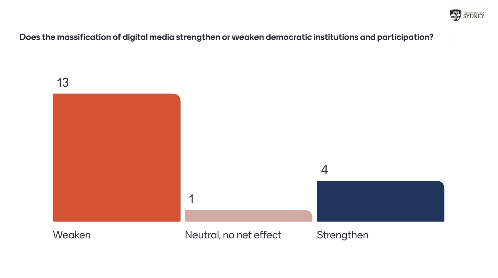

## Acknowledgement of Country

I would like to acknowledge the Traditional Owners of Australia and recognise their continuing connection to land, water and culture. The University of Sydney is located on the land of the Gadigal people of the Eora Nation. I pay my respects to their Elders, past and present.

## Today's class {.smaller}

Platforms and the Future of Political Communication (Ch 13)

- **Verdict week**: we return to the question we opened with in Week 1, and walk back through the evidence from every week.
- Read the textbook's own conclusion: what the authors think the field has learned, what it has left out, and where it is going.
- **This week's reading**: Abendschön & García-Albacete [-@abendschonItsMansOnline2021] on the **gender gap in online political discussion**, one last piece of evidence for the verdict: who gets to speak in the platform public sphere?
- Build a **verdict** you can defend, with named concepts and specific evidence.
- **Prepare for the exam (A3)**: format, timing, what a strong essay looks like, and some practice.

::: {.callout-tip}
### Note
When not otherwise referenced, materials are based on and adapted from Klinger, Kreiss & Mutsvairo (2023), *Platforms, Power, and Politics* (Polity), Ch 13.
:::

## In-class task! Back to Week 1 {.smaller}

::: {.center}

**Does the massification of digital media strengthen or weaken democratic institutions and participation?**

:::

You answered this in Week 1, before any evidence. Answer it again now, **before** we review the semester: [menti.com/al95qcjc7sbx](https://www.menti.com/al95qcjc7sbx)

- Has your answer changed since August? If it has, **which week** changed it?
- We will vote once more at the end of today's class.

## What you said in Week 1 {.smaller}

{fig-alt="Mentimeter bar chart for the question 'Does the massification of digital media strengthen or weaken democratic institutions and participation?': Weaken 13, Neutral, no net effect 1, Strengthen 4" width="80%" fig-align="center"}

In Week 1, **13 of 18** of you said digital media **weaken** democracy, **4** said they strengthen it, and **1** said no net effect. Compare with today's vote: **who moved, and in which direction?**

# Where We Started

## Week 1: the question and the swing {.smaller}

::: {style="font-size: 0.85em;"}

::: {.columns}
::: {.column width="55%"}
- **Techno-optimism**: the Arab Spring (2010–11) read as proof that social media could topple regimes.
- **The darker narrative**: Brexit and the 2016 US election, and platforms blamed for disinformation, manipulation and polarisation.
- Neither story was the whole truth. The swing between them was itself the problem: it assumed technology **does** things to democracy on its own.
:::

::: {.column width="45%"}
**The dual nature of platforms (Week 1)**

| Potential benefits | Potential costs |
|---|---|
| Engagement and mobilisation | Concentrated communication power |
| More diverse viewpoints | Information disorders |
| Direct leader–public contact | Polarisation |
| | Commodified, microtargeted discourse |
:::
:::

::: {.callout-important}
### The idea we started from
Democracy is a **contingent achievement**: it has to be continually performed, legitimated and protected. Platforms neither guarantee it nor destroy it on their own.
:::

:::

## How the semester was built {.smaller}

- The **textbook chapter** was the constant spine, every week.
- Each lecture added **one piece of evidence** to a running verdict.
- **Three legs** carried the main argument, each with an additional required reading:

| | Week 3: Leg 1 | Week 7: Leg 2 | Week 8: Leg 3 |
|---|---|---|---|
| **Theme** | Algorithmic gatekeeping crisis | Participation paradox | Institutional bypass via Internet capital |
| **Reading** | Soffer (2021) | Heiss & Matthes (2019) | Bailo (2025); Marolla et al. (2026) |
| **What is bypassed** | Human gatekeepers | The cost of participating | Civic associations and their social capital |

- Every other week added its own evidence: context (Week 2), **public spheres** (Week 4), journalism (Week 5), strategy (Week 6), governance (Week 9), **misinformation** (Week 10), **populism and extremism** (Week 11), and entertainment (Week 12). Weeks 4, 10 and 11 together tell us what happens to the **public sphere** itself.

# The Evidence File

## Leg 1: who decides what we see? (Weeks 3 and 5) {.smaller}

::: {.columns}
::: {.column width="50%"}
**Week 3: algorithmic gatekeeping**

- Platforms are data + algorithms + interfaces + business model + governance. They hold power across **six dimensions** (Ch 3).
- Soffer [-@sofferAlgorithmicPersonalizationTwoStep2021]: algorithms are **the new opinion leaders**. They personalise like the two-step flow did, but **invisibly**, without the social accountability a human opinion leader had.
- Case: Facebook's 2018 news feed change reshaped Australian journalism's reach with no public debate.
:::

::: {.column width="50%"}
**Week 5: journalism's response**

- Gatekeeping, agenda setting and framing still happen, but **many more actors** perform them.
- Meraz & Papacharissi [-@merazNetworkedGatekeepingNetworked2013]: on #Egypt, prominence was **crowdsourced**. The crowd was the filter, and the process was public.
:::
:::

::: {.callout-important}
### Leg 1 verdict
Platforms **redistributed** gatekeeping rather than destroying it: more open, but less accountable. The new gatekeepers (ranking systems, crowds) answer to no editor and no public.
:::

## Leg 2: who participates? (Weeks 6 and 7) {.smaller}

::: {.columns}
::: {.column width="50%"}
**Week 6: strategic communication**

- Cambridge Analytica / Brexit as a **moral panic**: persuasion effects are small, and voters are not dupes.
- Kreiss & McGregor [-@kreissMcGregorTechnologyFirms2018]: technology firms are **active agents** in campaigns, not neutral channels. Campaigns work "on terms shaped by these firms".
:::

::: {.column width="50%"}
**Week 7: the participation paradox**

- Heiss & Matthes [-@heissMatthesDoesIncidental2019]: incidental exposure boosts **low-effort** participation for everyone.
- But it does not raise **high-effort** participation, and for the disengaged the effect is negative.
- The participation gap that matters most is **reinforced**, not closed.
:::
:::

::: {.callout-important}
### Leg 2 verdict
Platforms make **participating cheaper**, but not **more equal**. The people who already had resources, skills and interest gain most. The danger is not mass manipulation; it is a quieter **widening of the gap**.
:::

## Leg 3: who organises? (Week 8) {.smaller}

- Platforms shift organising from **collective action** (formal organisations, resource-heavy) towards **connective action** (personalised, decentralised, low-cost). Hybrid forms are the norm.
- Bailo [-@bailoBreakingOutLegacy2025]: **Internet capital** let the Five Star Movement reach people that social-capital networks structurally excluded. But the breakthrough came **after legacy media validation**.
- Marolla et al. [-@marollaAffordingFragmentedAudiences2026]: the movement's five platforms **decentralised** participation on grassroots platforms and **re-centralised** power on leadership platforms.

::: {.callout-important}
### Leg 3 verdict
The bypass is **real but partial and conditional**. Escaping *external* gatekeepers does not mean escaping gatekeeping: it can come back *inside* the organisation, in a less visible form.
:::

## The Internet can't bootstrap a mobilisation {.smaller}

::: {.columns}
::: {.column width="50%"}
**In autocracies** [@weidmannInternetPoliticalProtest2019]

- Local-level data across about 70 autocracies.
- The Internet **reduces how often protest starts**: regimes use it for propaganda, censorship and surveillance.
- Once protest starts, the Internet helps it **persist and spread**.
:::

::: {.column width="50%"}
**In democracies** [@bailoBreakingOutLegacy2025]

- The Internet extends mobilisation beyond dense civic networks, to **disengaged and dispersed** citizens.
- But **legacy media** do the legitimising: news attention builds collective efficacy and widens reach.
:::
:::

::: {.callout-important}
### The common pattern
In democracies and autocracies alike, the Internet is a powerful tool for **sustaining** a mobilisation. It rarely brings one into existence on its own.
:::

## The public sphere under strain (Weeks 4, 10, 11) {.smaller}

::: {style="font-size: 0.78em;"}

::: {.columns}
::: {.column width="33%"}
**Week 4: public spheres**

- Platforms scale public spheres beyond the nation, and help like-minded people find each other: climate activists, and also hate groups.
- **Dissonant** and **unedited** public spheres: conflict over consensus, and an "inability to communicate across difference".
- Filter bubbles and echo chambers: evidence "**mixed at best**". The method matters (trace data vs surveys).
:::

::: {.column width="33%"}
**Week 10: misinformation**

- Misinformation vs **disinformation** (intent to deceive) vs **malinformation** vs **propaganda** (long-term campaigns).
- MDP is old; platforms change its **reach and scale**.
- MDP works through **identity**: partisanship as a "mega-identity" that raises the stakes of politics.
- Trust in **knowledge-producing institutions** is under assault, often from political elites.
:::

::: {.column width="33%"}
**Week 11: populism and extremism**

- Populism as a **thin-centred ideology**: the pure people vs the corrupt elite.
- **Anti-intermediation**: populists claim to need no parties, unions or media, and platforms offer a "direct channel".
- Engagement-driven business models reward anger.
- Populism, radicalism and **extremism** are not the same: democracies can live with radicals, not with extremists.
:::
:::

::: {.callout-important}
### Public sphere verdict
Platforms didn't lock us into bubbles. The damage is subtler: **shared reality and trust** erode, identity raises the stakes of every disagreement, and anti-intermediation turns the bypass of institutions into a **political programme**.
:::

:::

## Context, rules and fame (Weeks 2, 9, 12) {.smaller}

::: {style="font-size: 0.9em;"}

| Week | What it added to the verdict |
|---|---|
| **2**: Definitions and variations | The **same platforms** have different effects in different political systems (US vs Switzerland; backsliding democracies; adapting autocracies). Wolfsfeld et al. (2016): people who **combine** traditional and social media participate most. |
| **9**: Governance | Rules move **where** power sits (state, platform, algorithm, Oversight Board) without making it visible. Algorithmic moderation risks opacity and de-politicisation [@gorwaAlgorithmicContentModeration2020]. Regulation is not automatically pro-democratic. |
| **12**: Entertainment | A **fourth, softer bypass** via fame. Wood et al. [-@woodJustUsEveryday2016]: the shift from superstar to **everyday** celebrity politicians, and "normality" as a brand for elites. |

:::

## In-class task! Match the concept {.smaller}

::: {style="font-size: 0.82em;"}

One key concept from each leg. On Mentimeter, **match each concept to its definition**. Careful: there is **one definition too many**.

::: {.columns}
::: {.column width="30%"}
**Concepts**

1. **Networked gatekeeping** (Leg 1, Week 5)
2. **Incidental exposure** (Leg 2, Week 7)
3. **Internet capital** (Leg 3, Week 8)
:::

::: {.column width="70%"}
**Definitions**

A. Dense, local, reciprocal networks built through civic associations, which structure who gets pulled into political participation.

B. Coming across political content **without searching for it**, e.g. a friend's share turning up in your feed.

C. The stock of digital resources that enable collective action **independently of existing social capital** resources.

D. Many actors, including trusted but **non-institutional** curators, with unequal levels of power, deciding together what circulates and gains prominence.
:::
:::

**Then**: which definition was left over, and why does it matter for Leg 3?

:::

::: {.notes}
Answers: 1 → D, 2 → B, 3 → C. A is the distractor: it defines social capital, the thing Internet capital is meant to substitute for (Bailo 2025).
:::

# The Textbook's Conclusion

## Why this book? {.smaller}

- A **narrow** definition of political communication [Schuetz 2009, cited in Ch 13]: communication between politicians, media and citizens to construct "meaning about political practices".
- The authors chose a **broad** one: the political "spills out" into identity, entertainment, movements, lifestyles and health. Platforms sit at the centre because they are the **infrastructure** for much of social life, not only politics.
- The research findings are a "**dizzying array**", including contradictory ones:

| Strengthens? | Weakens? |
|---|---|
| Social media could reduce political misconceptions in the US [@garrettSocialMediasContribution2019] | Misinformation and disinformation corrupting public spheres around the world [@persilySocialMediaDemocracy2020] |
| Exposure to social media increased political awareness in rural Pakistan [@ahmadUseSocialMedia2019] | Polarisation in commercial, politicised digital ecosystems [@iyengarOriginsConsequencesAffective2019] |
| Expanded public spheres include voices formerly excluded | |

## The book's model, in one sentence {.smaller}

> Technologies are introduced into political, social, economic and technological environments **where we are already organised to do things**. (Ch 13)

- People are **agents** in media, not passive recipients. They use platforms in line with pre-existing goals and identities ("uses and gratifications").
- So "the very same platforms that support global movements for racial justice can also support **would-be authoritarians**".

::: {.callout-important}
### This is why the verdict question is hard
"Does digital media strengthen or weaken democracy?" assumes the effect sits in the technology. The book's answer is that the effect comes from **technology × institutions × people**. That is exactly what Week 2's US/Switzerland contrast showed.
:::

## Looking beyond the West {.smaller}

- Political communication research has been mostly **Western and democracy-centric**. The book deliberately drew on the Global South and on non-dominant groups.
- **The lesson for established democracies**: they are not "timelessly stable political systems that stand outside of history". They have much to learn from other countries, and have themselves destabilised other governments (Cold War interventions, colonial legacies).
- **Platforms are global, their decisions are local in effect**: when platforms decide not to invest in content moderation in local languages, the result can be **ethnic violence and democratic destabilisation**.
- Non-democracies matter too: how do journalists, civil society and ordinary people keep **dissent** alive under repression?

## What the book (and the field) leaves out {.smaller}

::: {.columns}
::: {.column width="50%"}
**Not covered in the book**

- AI technologies (GenAI and Agenting AI)
- Radio, still central in many countries.
- A dedicated chapter on **theories and methods** (framing, agenda setting, mediatisation; computational and network methods).
- The arrival of physicists and computer scientists in the field: e.g. neutral "drifter" bots on Twitter to test whether bias comes from platform design or from users (Chen et al. 2021).
:::

::: {.column width="50%"}
**Under-studied in the field**

- **Visual** communication: memes, gifs, video, graffiti. Most studies still use text, partly because platforms **restrict data access**.
- **Audio**: podcasts (remember Week 12).
- Music, fashion, and **games**.
- Race, ethnicity, social power, colonialism.
- **Interpretation**: it is not enough to be "swimming in data points" (Anderson 2021).
:::
:::

## Future trajectories {.smaller}

::: {style="font-size: 0.88em;"}

::: {.incremental}
1. **Comparative and longitudinal research**: across democracies, autocracies, mixed regimes and transitions, and over time. Some countries are backsliding while others make democratic gains.
2. **New platforms**: when the book was written, very few studies looked at TikTok. The platforms of the future "might not be the same platforms that are with us today". And these platforms might also include AI...
3. **Data access**: research on platforms' effects depends on access that platforms control.
4. **Cross-platform research**: in a hybrid media system, information moves from news sites through messaging apps to other platforms. Studying one platform cuts off where ideas come from (recall Marolla et al.'s **five** M5S platforms).
5. **Fragmentation**: after a decade of consolidation, audiences may become more **dispersed**, and the Internet itself may split along national governance systems.
:::

:::

## In-class task! Chapter 14 {.smaller}

::: {.center}

The authors say the book "could have been three times as long".

**You are writing Chapter 14. What is it about?**

:::

On Mentimeter, in one line:

1. The **topic** (something the book missed, or something that has happened since 2023).
2. **Why** it matters for the running verdict: does it point to strengthening, weakening, or a new condition?

Examples to get you started: generative AI and chatbots as sources of political information (remember the Week 3 poll), messaging apps, gaming communities, the creator economy.

# This Week's Reading: Who Speaks Online?

## Why this paper? {.smaller}

Abendschön & García-Albacete [-@abendschonItsMansOnline2021], *Information, Communication & Society*.

- This is a good concluding reminder that what we observe at the end (the effect) is Technology X People X Institutions

- Ch 13 cites it in one line: political communication is "structured by things such as race and gender". The paper shows **how**.
- **The hope it tests**: the internet as an **equaliser**. Women's lower participation was explained by **time and resources** (part-time work, unpaid care). Cheap, flexible online tools should close the gap.
- **The puzzle**: the gap did not close. Is the online gap just the **old** offline gap moved online, or a **new** gap with new causes?
- **The claim**: it is a **new** gap. Talking politics online is **more costly for women than for men**, for reasons that have little to do with time and money.
- **Why it matters for the verdict**: political talk online increasingly feeds public opinion and news (Week 4, Week 5). If some voices stay out, the platform public sphere is **less representative** than it looks.

## Old gap or new gap? {.smaller}

::: {.columns}
::: {.column width="50%"}
**The old gap (offline)**

- **Resources**: women hold lower-status, lower-paid jobs, or unpaid work.
- **Time**: the "double burden" of paid work and household care.
- **Situation**: unpaid work does not bring the networks that paid work does.
:::

::: {.column width="50%"}
**The new gap (online): three obstacles**

1. **Hostility**, objective and perceived: reactions to women's political posts are harsher; women also perceive more incivility.
2. **Publicity and shareability**: a post travels far beyond the audience you imagined (remember *context collapse*, Week 4).
3. **Gendered socialisation**: girls are encouraged to be cooperative and conflict-avoidant; politics is still coded a "man's world".
:::
:::

::: {.callout-important}
### Visibility is the key variable
Gender gaps are small for **low-visibility** activities (liking, following, sharing) and large for **high-visibility** ones (posting comments, discussing politics). Compare Heiss & Matthes in **Week 7**: low-effort vs high-effort participation.
:::

## Data and design {.smaller}

- **GESIS Panel** (Germany, 2017 wave): a probability-based panel of German residents aged 18–70. **2,180** respondents who use the internet.
- Its unique feature: **parallel questions** on discussing politics **online** ("used the internet to discuss politics") and **offline** (with friends, family, people you know). Same people, both channels, so the two gaps can be compared directly.
- **Personality**: the **Big Five** traits (openness, conscientiousness, extraversion, agreeableness, emotional stability), used to make the different *costs* of speaking visible.
- **Controls**: education, age, occupation, children, partner, friends, membership of political and social organisations.
- **Method**: a bivariate probit model (two linked equations: online and offline discussion), with interactions between gender and each trait.

**Hypotheses**

- **H1**: personality matters **more online** than offline.
- **H2**: women need **more** openness and extraversion than men to discuss politics online.
- **H3**: **agreeableness** depresses online discussion, more for women than for men.

## In-class task! Predict the gap {.smaller}

Among German internet users in 2017, what share **discussed politics sometimes or often**?

1. **Offline**, men: \_\_ % · women: \_\_ %
2. **Online**, men: \_\_ % · women: \_\_ %

And one more: **agreeable** people are positive, caring, trusting and cooperative. Does being very agreeable make **women** less likely to discuss politics online? What about **men**?

- Answer on Mentimeter. The results are on the next slides.

## Findings: a gap, online and off {.smaller}

::: {style="font-size: 0.88em;"}

| | Men | Women | Gap |
|---|---|---|---|
| Discuss politics **offline** (sometimes/often) | 86% | 78% | 8 points |
| Discuss politics **online** (sometimes/often) | 17% | 10% | 7 points |

- Online discussion is **rare** (13% overall), and the relative gap is far larger online: men are **1.7 times** as likely as women to talk politics online.
- The gender gap **survives every control**: education, age, occupation, family, networks, personality.
- **Old explanations work offline, not online**: occupation and family situation help explain offline talk, but not online talk. The unemployed and retired are *more* likely to discuss online: platforms don't need face-to-face or formal networks.
- **H1 supported**: three of the five traits matter for online discussion; only one (openness) for offline.

:::

## The key finding: agreeableness {.smaller}

::: {.columns}
::: {.column width="55%"}
Probability of discussing politics **online**:

| | Least agreeable | Most agreeable |
|---|---|---|
| **Women** | **20%** (higher than men) | **6%** |
| **Men** | no difference | no difference |

- **H3 supported**: agreeable women stay out of online political talk. For men, agreeableness makes **no difference**.
- Offline, agreeableness makes no difference for either.
:::

::: {.column width="45%"}
**And H2 is not supported, in a revealing way**

- Openness and extraversion **raise men's** online discussion (e.g. men's probability rises from about 10% to 21% across levels of openness).
- They **don't raise women's**. It is not that women need *more* extraversion to speak: the traits that help men simply **don't pay off** for women.
:::
:::

::: {.callout-important}
### The authors' reading
"A hostile online climate does not even allow open and extravert women to take an active part in discussions. Instead, only women with a very low level of agreeableness dare to take part."
:::

## What the reading adds, and its limits {.smaller}

::: {style="font-size: 0.9em;"}

| Textbook (Ch 13) | Abendschön & García-Albacete (2021) |
|---|---|
| Political communication is "structured by things such as race and gender" | **How**: the online gap is a **new** gap, driven by the costs of **visibility**, not time or money |
| Platforms expand public spheres to "voices formerly excluded" | Lower cost of access ≠ equal voice: the people who speak are a **selected** group |
| "Reject cynicism and the demonization of our fellow citizens" | Incivility is not only unpleasant: it **filters out** some speakers, unequally |

**Limits to keep in mind**

- **Cross-sectional** survey: correlations, not causes. The authors themselves call for experiments (e.g. controlled chat rooms varying aggressiveness and anonymity).
- One country (Germany), one year (2017), before TikTok and short video.
- **Self-reported**, yes/no measures of "discussing politics online", with no distinction between platforms.
- The mechanisms (hostility, publicity, socialisation) are **argued**, not measured directly.

:::

# The Verdict

## Five routes around institutions, one pattern {.smaller}

::: {style="font-size: 0.82em;"}

| | What platforms route around | What gets **wider** | What gets **thinner** |
|---|---|---|---|
| **Leg 1**: algorithms | Editors, opinion leaders | Range of voices and sources | Accountability for what is ranked and seen |
| **Leg 2**: cheap participation | The cost of taking part | Low-effort participation | Equality of high-effort, **high-visibility** participation |
| **Leg 3**: Internet capital | Civic associations, party networks | Who can be reached and mobilised | Visible, accountable internal organisation |
| **Weeks 4, 10, 11**: the public sphere | Journalists, experts, parties as intermediaries | Publics and counterpublics, voices formerly excluded | **Shared reality** and **trust** in knowledge institutions |
| **Week 12**: fame | Party machines, structured interviews | Who can reach the public | Accountability for the **record** (vs the **persona**) |

::: {.callout-important}
### The pattern
Each time, platforms **widen access** and **thin accountability**. Populism (Week 11) is, in a sense, the ideology of this bypass: "we don't need parties, unions or media".
:::

:::

## A proposed verdict {.smaller}

::: {.center}
**Digital media rarely strengthen or weaken democratic institutions on their own. They redistribute institutional functions (gatekeeping, mobilisation, representation) towards actors that are more open but less accountable. Whether that helps or harms democracy depends on the conditions.**
:::

**The conditions we found this semester:**

- **The political system** the platform lands in (Week 2).
- **Validation by legacy institutions**, especially journalism (Weeks 5 and 8).
- **Who has the resources and skills** to use the tools (Week 7), and who can **afford to be visible** in a hostile environment (this week's reading).
- **Governance**: whether rules make power visible, or just move it (Week 9).
- **Who gets to count** as "the people", or as "normal" (Weeks 11 and 12).

::: {.callout-tip}
### This is *a* verdict, not *the* verdict
You don't have to agree with it. A good verdict is one you can **defend with named concepts and specific evidence**, and whose limits you can state.
:::

## The authors' final thoughts {.smaller}

::: {style="font-size: 0.9em;"}

- What is new in the platform era sits alongside **continuities**: power, political elites and social hierarchies "are very much still with us".
- The book ends with "amazing possibilities for political expression and political action", and "frightening threats to democracy those same platforms facilitate".

> "It will take all of us to reaffirm the importance of knowledge-producing institutions such as journalism, to reject cynicism and the demonization of our fellow citizens, to trust across lines of political difference [...] to hold platforms and other powerful interests accountable for their roles in democracy". (Ch 13)

:::

## What the authors ask for, and why {.smaller}

::: {style="font-size: 0.8em;"}

Each task in the quote answers a problem we found this semester: something that got **thinner** as platforms widened access.

| The authors ask us to... | Because this semester showed that... | Where |
|---|---|---|
| **Reaffirm knowledge-producing institutions** such as journalism | Gatekeeping moved from editors to algorithms and crowds, which answer to no one | Leg 1 (Weeks 3, 5) |
| **Reject cynicism and demonisation; trust across difference** | Shared reality and trust are eroding; identity raises the stakes of disagreement; hostility pushes some people out of the conversation | Weeks 4, 10, 11; this week's reading |
| **Hold platforms accountable** | Regulation and self-regulation move power around without making it visible | Week 9 |

::: {.callout-important}
### So the verdict is not fixed
Platforms set the conditions, but they don't settle the outcome. Whether digital media end up strengthening or weakening democracy depends on what **citizens, journalists, regulators and platforms do next**.
:::

:::

## In-class task! Your verdict {.smaller}

### Does the Internet strengthen or weaken democracy?

- **Write your verdict in two sentences** on Mentimeter:
   - Sentence 1: your answer, using **one named concept** from the unit.
   - Sentence 2: **one specific piece of evidence** (a case or a study) that supports it.

::: {.callout-tip}
### This is also exam practice
"Named concept + argument + specific example" is exactly what the A3 essay asks you to do.
:::

# Preparing for the Exam (A3)

## The exam at a glance {.smaller}

::: {.columns}
::: {.column width="50%"}
**Format**

- **90 minutes**, in person, invigilated, **closed book**.
- **30 multiple-choice questions** (1 point each): 30% of the exam mark.
- **1 short essay** (70 points): 70% of the exam mark. Everyone answers the same prompt.
- Date and venue: set by the **central exam timetable**. Check your personal timetable.
- A3 is worth **30%** of the unit but is a hurdle task (you must pass the exam to pass the unit). 
:::

::: {.column width="50%"}
**Scope**

- The **whole semester**: lectures, tutorials and the textbook, Ch 1–13.
- Weighted towards the theory-heavy outcomes:
  - **Concepts and definitions** (Ch 1–2)
  - **Platform power and affordances** (Ch 3)
  - **Public spheres, publics, counterpublics** (Ch 4)
  - **Misinformation, disinformation, propaganda** (Ch 10)
- But any week's material is fair game.
:::
:::

## Manage your time {.smaller}

| Section | Suggested time | Share of the mark |
|---|---|---|
| 30 MCQs | about **30 minutes** | **30%** |
| 1 short essay | about **50 minutes** | **70%** |
| Buffer | about **10 minutes** | |

::: {.callout-important}
### Time and marks don't match
The essay takes just over half your time but carries more than twice the marks of the MCQs. **Don't spend essay time perfecting MCQ answers.** These timings are a guide: you have the full 90 minutes to use as you choose.
:::

- A focused essay of **roughly 300–500 words** beats a long, unfocused one.
- Running out of time is something the exam is partly testing. **Plan for 5 minutes before you write.**

## The MCQs: precision, not recognition {.smaller}

The questions test whether you know **what distinguishes a concept from the one next to it**, not just whether you have heard of it.

Example from the A3 task description:

> Which of the following best distinguishes *disinformation* from *misinformation*, as the terms are used in the unit?
>
> A) Disinformation is spread only by state actors, while misinformation is spread by ordinary citizens
>
> B) Disinformation refers to false information shared without any intent to deceive, while misinformation is deliberately created to mislead
>
> C) Disinformation is false or misleading information produced with the intent to deceive, while misinformation is factually false but lacks that intent
>
> D) There is no meaningful difference between the two terms

## In-class task! Concept pairs {.smaller}

On Mentimeter: **for each pair, what is the one difference that matters?**

::: {.columns}
::: {.column width="50%"}
1. Misinformation vs **disinformation**
2. Disinformation vs **propaganda**
3. Public sphere vs **counterpublic**
4. Collective action vs **connective action**
:::

::: {.column width="50%"}
5. Populism vs **radicalism** vs **extremism**
6. State regulation vs **self-regulation**
7. Affective vs **ideological** polarisation
8. Superstar vs **everyday** celebrity politician
:::
:::

Then: the answer to the example on the previous slide is **C**. Why are A and B tempting?

## The essay: what we're looking for {.smaller}

::: {style="font-size: 0.8em;"}

| Criterion | What a strong answer does |
|---|---|
| **Conceptual precision** | Names at least two unit concepts and defines them precisely, in the unit's own terms |
| **Argument & synthesis** | Uses the concepts **together** to build an argument, not a list of definitions |
| **Use of example** | A **specific** example that shows the argument's mechanism, with its limits acknowledged |
| **Organisation & time management** | Focused, complete, roughly 300–500 words |
| **Written expression** | Clear, precise, economical prose |

::: {.callout-tip}
### The most common way to lose marks
Defining two concepts in the first paragraph, then never **using** them again. Every concept you name should do work in your argument.
:::

:::

## In-class task! Plan an essay in 5 minutes {.smaller}

::: {style="font-size: 0.78em;"}

The illustrative prompt from the A3 task description:

> Political communication scholars argue that platforms have not simply added a new communication channel to politics, but have changed the underlying dynamics of political communication itself. Drawing on **at least two named concepts** from the unit (e.g. affordances, a dimension of platform power, publics/counterpublics, or the misinformation/disinformation distinction), explain what has changed and why it matters. Illustrate your argument with **at least one specific example**.

In pairs, **plan, don't write**:

1. Your **claim** in one sentence.
2. **Two concepts**, and how each one moves the argument forward.
3. **One example**, and one limit of that example.

Share your plan on Mentimeter. We'll look at two or three together.

:::

## Revision checklist: key concepts by chapter {.smaller}

::: {style="font-size: 0.8em;"}

::: {.columns}
::: {.column width="50%"}
- **Ch 1**: hybrid media system; affordances; platforms as political actors
- **Ch 2**: an expansive definition of political communication; institutionalised communicators; how political systems condition effects
- **Ch 3**: what a platform is; the dimensions of platform power
- **Ch 4**: public spheres, counterpublics, affective publics; filter bubbles and echo chambers; public opinion
- **Ch 5**: gatekeeping, agenda setting, framing; the "four Ps" of journalism
- **Ch 6**: political marketing, PR, public diplomacy, crisis communication, digital lobbying
- **Ch 7**: the four ages of campaigning; persuasion, mobilisation, demobilisation
:::

::: {.column width="50%"}
- **Ch 8**: movements; collective vs connective action
- **Ch 9**: platform governance; state regulation vs self-regulation; content moderation
- **Ch 10**: misinformation, disinformation, malinformation, propaganda; types of polarisation
- **Ch 11**: populism as a thin-centred ideology; radicalism vs extremism
- **Ch 12**: politainment; celebrity politicians; political influencers
- **Ch 13**: why context matters; future research trajectories
:::
:::

::: {.callout-tip}
### How to revise
For each concept: (1) a one-sentence definition, (2) the concept it is most easily confused with, (3) one specific example. If you can do all three from memory, you're ready.
:::

:::

# Summary

## Key takeaways {.smaller}

::: {style="font-size: 0.88em;"}

1. The Week 1 swing between techno-optimism and techno-pessimism was the wrong frame. Technologies land in environments **where we are already organised**: effects come from technology, institutions and people together.
2. Across the three legs, platforms **redistribute** institutional functions: gatekeeping to algorithms (Leg 1), participation to cheap but unequal forms (Leg 2), organisation to Internet capital (Leg 3), and representation to persona (Week 12). In the public sphere (Weeks 4, 10, 11), the cost is **shared reality and trust**, and populism turns bypassing institutions into a programme.
3. The pattern: **access widens, accountability thins**. The Internet can sustain a mobilisation, but rarely bootstraps one without legacy institutions.
4. Abendschön & García-Albacete [-@abendschonItsMansOnline2021]: lower costs of access did not equalise voice. Online, a **new gender gap** opens around **visibility**: agreeable women stay out of political talk, and the traits that help men speak don't help women. **Access is not the same as equal voice.**
5. **The conditions decide**: the political system, validation by journalism, resources and skills, who can afford to be visible, governance, and who counts as "the people".
6. The field's next steps: **comparative, longitudinal, cross-platform** research, beyond the West and beyond text, and fought over **data access**.
7. **Exam**: precise concepts, used together, grounded in specific examples.

:::

## {.center}

# Attendance

Get your phone out!

## {.center}

# Any quick question?

## {.center}

# Thank you, and good luck in the exam!

## References
